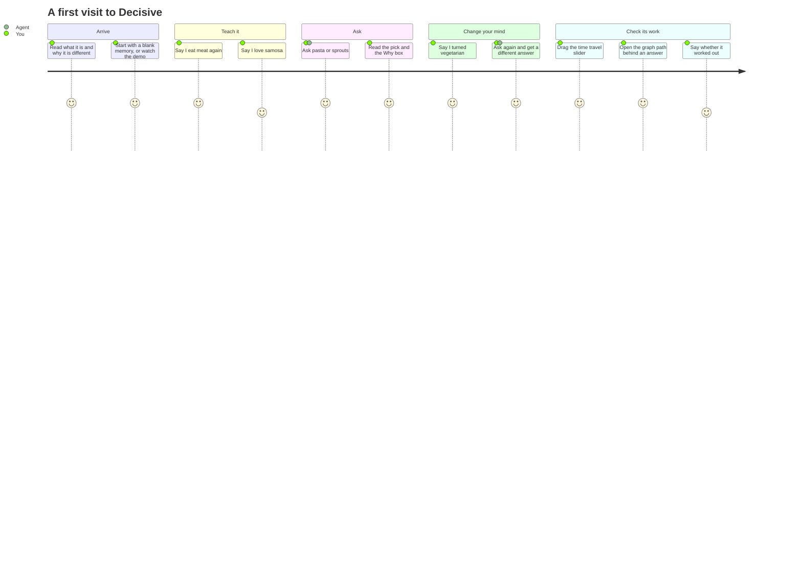
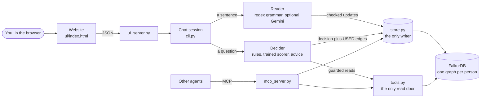
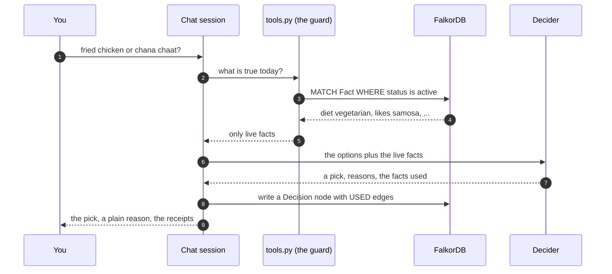
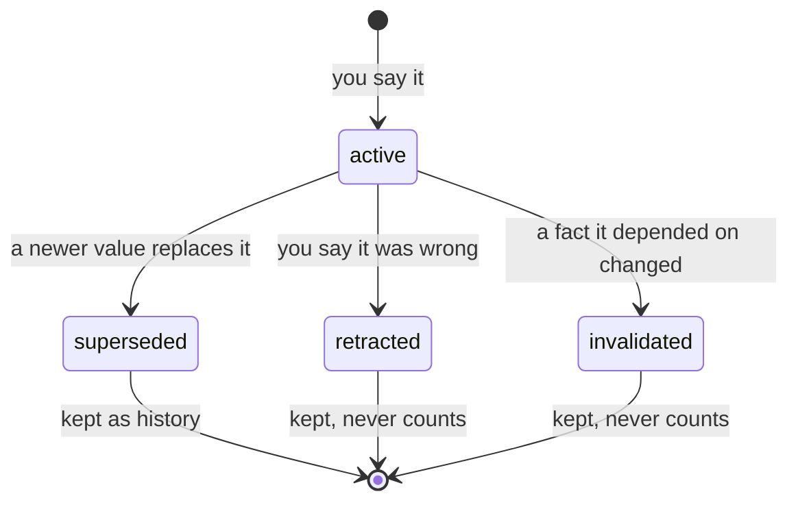
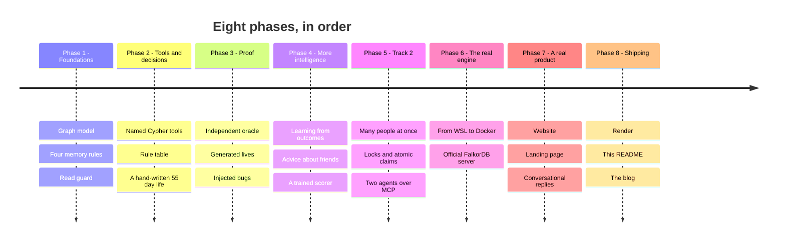
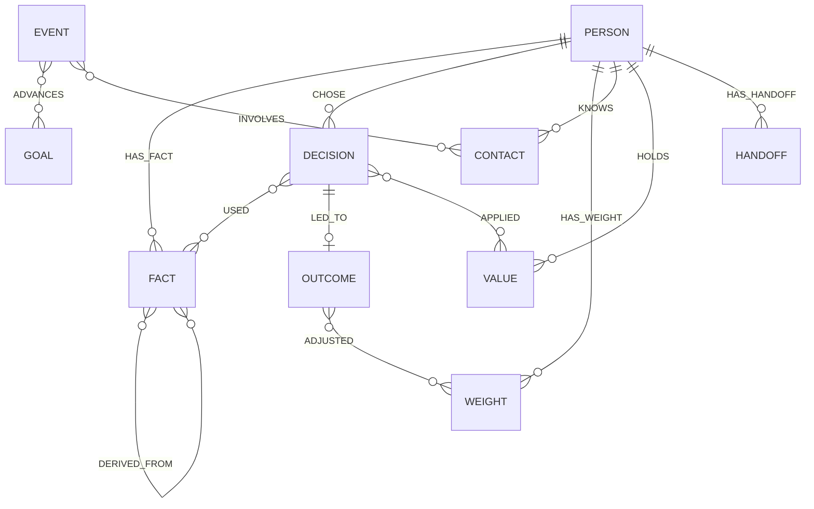

# Decisive

**An agent that never gives you advice based on something that stopped being true.**

I'm 20, I overthink everything, and for a long time I wanted one thing: someone who knows me well enough to just say *"yes, have the sweet, you've been off sugar for ten days"* or *"let this one go, it's the first time she's cancelled."* Not a generic chatbot. Someone who remembers who I am **today**.

The problem is that most AI memory only ever adds. Tell it in March you eat meat, tell it in May you turned vegetarian, and it still suggests chicken, because both sentences are sitting in its memory and nothing says which one is still true. So I built the opposite: a memory where every fact has a life, and only the living ones are allowed near an answer. The memory is a [FalkorDB](https://www.falkordb.com) graph.

- **Live demo:** *(your Render link)*
- **Blog (the story of building it):** [BLOG.md](BLOG.md)
- **Video:** *(your video link)*
- **Submission answers:** [SUBMISSION.md](SUBMISSION.md)

Everything in here is fictional data. No real person has used it yet, and I say so again in the limits section, because it matters.

---

## What it does, in one minute

You talk to it in plain sentences. It remembers some, forgets nothing, and uses only what is true now.

| You say | It does |
|---|---|
| "I eat meat again" | stores `diet_style = non_veg` from today |
| "I turned vegetarian" | stores the new fact, keeps the old one as history, and drops anything that depended on it |
| "fried chicken or chana chaat?" | picks one, says why, and lists the exact facts it used |
| "that was wrong about paneer wrap" | retracts that fact and everything built on it |
| "my friend Sam cancelled again, should I say something?" | looks at the pattern, your promises and your values, and gives advice that is not just flattery |

Then you can drag a slider to see what it believed on any day, or open the graph and watch the exact path from you to an answer light up.

---

## The user journey



Every visitor gets a new, empty, private memory (a random id kept in that browser tab). Nobody is pre-loaded.

---

## How it works



The rule I care about most: **the database decides what is true.** An LLM, if you turn one on, can only turn a sentence into updates or reword an answer, and everything it produces is checked before anything is written. The whole thing runs, and is tested, with the LLM off.

### What happens when you ask a question



### The idea in one picture: every fact has a life



Nothing is ever deleted. Only `active` facts can reach an answer, and that is enforced in one place, not by hoping every query remembers.

---

## How it was built, in phases



1. **Foundations.** I started with the four rules before any code that talked: supersede, retract, cascade, guard. If those are wrong, nothing above them can be right.
2. **Tools and decisions.** Named, parameterised Cypher queries (the only way the agent can read), a decision rule table, and Meera, a hand-written 55-day life with traps in it, to test against.
3. **Proof.** A checker that never imports the agent, a generator that makes thousands of lives, and baselines that read the same graph with a dumber rule. This is the phase that taught me my first tests were too easy.
4. **More intelligence.** Learning from how a choice turned out, a judgment layer for advice about friends (patterns, promises, your values), and a small trained scorer to compare against the rules.
5. **Track 2.** Many people at once, many agents on one person, many processes on one slot, and two agents handing work to each other over MCP.
6. **The real engine.** I developed on an embedded FalkorDB, then moved everything to the official server in Docker and reran every result there.
7. **A real product.** A website you can understand in ten seconds: a landing page, an answer card that shows its reasons, a memory timeline with time travel, a graph view, and replies that sound like a person.
8. **Shipping.** Deploying, writing this, and a blog.

---

## Where it broke, and how it got fixed

This is the part I'm proudest of, honestly. Almost everything below was caught by a test I wrote, or by running it somewhere new.

| What broke | Why | The fix |
|---|---|---|
| The embedded FalkorDB would not install on Windows | `falkordblite` does not build on native Windows | Ran it in WSL, then moved to the official server in Docker |
| Docker failed in strange ways, then the image came out corrupt | My C: drive was nearly full (about 0.5 GB free) | Freed space, reset Docker, pinned `falkordb/falkordb:v4.22.1-alpine` |
| My own rule flagged my own code | A test says only three files may read facts; a helper script broke it | Added clearly labelled raw readers in `store.py` for evaluation only |
| My tests passed everything, which was suspicious | The question generator was too easy | Injected 7 known bugs on purpose; the first version caught only 4. Rebuilt the generator to aim at close calls. Now all 7 are caught |
| A checker disagreement on 28 of 1,478 friend questions | My generator broke a documented rule (the same value written twice is a no-op) | Fixed the generator, not the engine |
| Learning made accuracy drop | I rewarded good outcomes and punished bad ones equally | Learn from mistakes only |
| The trained scorer stalled around 92% | A pointwise model could not separate close pairs | Switched to a pairwise ranking model, and added a position feature for ties. The README says this used information from the test set |
| 111 active facts in a slot that should hold one | Eight threads wrote to one slot at once | A per-person lock, a repair step that keeps the history chain straight, and an atomic claim for handoffs |
| The two-agent MCP demo hung forever | The library returned a list as separate blocks | Wrapped the result in an object and made the demo fail fast |
| Three bugs that only appeared on Linux | A multiprocessing deadlock, an MCP server that lost its environment, and buffered output that looked frozen | Used `spawn`, passed the environment through (and warn when the database is unset), set `PYTHONUNBUFFERED` |
| A normal sentence set off the crisis filter | "hit me up" matched a worrying phrase | Fixed the pattern and added a test |
| The sentence reader missed simple cases | A regex was missing a space in "moved to" | Fixed and tested |
| My first website looked like a debug console | It spoke in `slot` and `valid_from` | Redesigned it several times: landing page, answer cards, timeline, a graph on a dark canvas |
| The local site kept showing the old page | The page is baked into the Docker image | Rebuild the container after any page change |
| Replies felt robotic ("Done: diet_style = non_veg") | I printed the stored fact | A conversational layer: it answers in plain sentences, then shows what was saved |
| Flaky tests on Windows | The server replied before reading the request body, which reset the connection | Read the body first |

### The night the deploy fought back


The first blueprint ran a separate paid database. I would not put a card on a hackathon, so I rebuilt it to run FalkorDB inside the web service. That built fine and then crashed: Render ran my whole `sh -c "..."` command as one program name. The fix was to stop telling it how to start and let the app read `PORT` from the environment.

---

## Tracks

- **Track 01, agents that act on connected data.** Named, parameterised query tools (`agent/tools.py`) exposed over MCP (`mcp_server.py`), multi-hop lookups (`related_facts`, cascade), PageRank over goal events, an explainable `shortestPath` audit trail from person to decision, and logged actions (treats, events, decisions).
- **Track 02, agent memory and coordination.** Memory that corrects itself: supersede, retract and cascade, a read guard, time travel (`get_fact_at`), persistent per-user graphs (one graph per user, isolated), and an audit trail. Many agents can share one person's memory: a stress test runs dozens of people and many agents in parallel, and agents hand work to each other through the graph (see "Track 2: concurrency and multi-agent coordination" below).

## What I would do next

- Teach it more than food and friends (work, money, health), and more foods than the 44 it knows today. It does not know Oreos yet, which is a small heartbreak.
- Put real people in front of it. Everything so far is synthetic.
- Let it ask "is this still true?" when a fact gets old.
- Keep memories across restarts on the live demo (today they reset when the free server sleeps).

---

## Results

All numbers are produced by `python run_eval.py` and pasted here from `results/*.md` by `scripts/update_readme.py`.

**Engine.** Every result below was produced against the official FalkorDB server (`falkordb/falkordb:v4.22.1-alpine`, graph module 4.22.1, Redis 8.10.2) running in Docker Desktop, except the learning simulation, which uses no database. The same evaluations, tests and mutation checks gave the same correctness results on the older embedded `falkordblite` build used during development. Throughput and latency depend on the engine and the machine, so the Track 2 table states its engine on its first line; on this laptop every query crosses Docker Desktop's WSL2 port forwarding, which makes the absolute numbers lower than the embedded build gave.

**How to read them.** Three readers answer the same questions against the same live graph with the same rules; only the read rule differs.

- *guarded (agent)*: only facts with status `active`.
- *last-write-wins*: reads every row ever stored, takes the newest per key. Fixes supersede but ignores cascade and retraction. What many simple memories do.
- *first-write*: takes the first value ever written per key. A deliberately simple baseline, not a state-of-the-art claim.

Both baselines also read goals without their status (an ended goal still counts). "Stale-use" counts only facts, not goals.

### Hand-written life (Meera, 55 days)

<!-- RESULTS:meera:start -->
15 questions. 95% Wilson interval in brackets.

| Reader | Task success | Stale-use | Wrongful-keep |
|---|---|---|---|
| first-write (no guard) | 9 of 15 (60.0%) [35.7-80.2] | 5 of 15 (33.3%) [15.2-58.3] | 2 of 15 (13.3%) |
| guarded (agent) | 15 of 15 (100.0%) [79.6-100.0] | 0 of 15 (0.0%) [0.0-20.4] | 0 of 15 (0.0%) |
| last-write-wins (no guard) | 12 of 15 (80.0%) [54.8-93.0] | 2 of 15 (13.3%) [3.7-37.9] | 2 of 15 (13.3%) |

Task success by trap type (correct answers out of n):

| Trap | n | first-write (no guard) | guarded (agent) | last-write-wins (no guard) |
|---|---|---|---|---|
| cascade | 1 | 0 | 1 | 0 |
| control | 1 | 1 | 1 | 1 |
| diet_change | 1 | 0 | 1 | 1 |
| dislike | 1 | 1 | 1 | 1 |
| double_change | 1 | 0 | 1 | 1 |
| goal_ended | 1 | 0 | 1 | 0 |
| promise | 3 | 3 | 3 | 3 |
| retraction | 1 | 0 | 1 | 0 |
| streak | 4 | 4 | 4 | 4 |
| taste_flip | 1 | 0 | 1 | 1 |

Guarded agent only:

| Metric | Result |
|---|---|
| Wrongful-drop (active fact hidden) | 0 of 15 (0.0%) |
| Cascade completeness | 2 of 2 (100.0%) |
| Time-travel accuracy | 10 of 10 (100.0%) |
| Audit coverage | 15 of 15 (100.0%) |
<!-- RESULTS:meera:end -->

### Generated lives (test split: seeds 300-499, never used to tune anything)

<!-- RESULTS:generated:start -->
3595 questions. 95% Wilson interval in brackets.

| Reader | Task success | Stale-use | Wrongful-keep |
|---|---|---|---|
| first-write (no guard) | 1857 of 3595 (51.7%) [50.0-53.3] | 1910 of 3595 (53.1%) [51.5-54.8] | 582 of 3595 (16.2%) |
| guarded (agent) | 3595 of 3595 (100.0%) [99.9-100.0] | 0 of 3595 (0.0%) [0.0-0.1] | 0 of 3595 (0.0%) |
| last-write-wins (no guard) | 2828 of 3595 (78.7%) [77.3-80.0] | 648 of 3595 (18.0%) [16.8-19.3] | 529 of 3595 (14.7%) |

Task success by trap type (correct answers out of n):

| Trap | n | first-write (no guard) | guarded (agent) | last-write-wins (no guard) |
|---|---|---|---|---|
| cascade | 170 | 0 | 170 | 0 |
| combined | 20 | 0 | 20 | 20 |
| diet_change | 539 | 0 | 539 | 511 |
| goal_ended | 235 | 0 | 235 | 0 |
| none | 1858 | 1857 | 1858 | 1858 |
| retraction | 323 | 0 | 323 | 0 |
| taste_flip | 450 | 0 | 450 | 439 |

Guarded agent only:

| Metric | Result |
|---|---|
| Wrongful-drop (active fact hidden) | 0 of 3595 (0.0%) |
| Cascade completeness | 494 of 494 (100.0%) |
| Time-travel accuracy | 1262 of 1262 (100.0%) |
| Audit coverage | 3595 of 3595 (100.0%) |
<!-- RESULTS:generated:end -->

### Learning from outcomes (simulated users)

Each simulated user has hidden preference weights. The agent starts with the defaults, sees only good, mixed or bad feedback on its picks, and learns from the bad ones. Rule and learning rate were chosen on development seeds 0-99; this table is seeds 1000+.

<!-- RESULTS:learning:start -->
100 simulated users per population, 60 trade-off decisions each. Each user has hidden preference weights; the agent only sees good / mixed / bad feedback and learns from bad outcomes. 'Agrees' = picks the option the user's hidden weights rank first.

| Users | Decisions | Fixed weights agree | Learned weights agree | Fixed regret | Learned regret |
|---|---|---|---|---|---|
| mild (0.6-1.6) | 1-20 | 1956 of 2000 (97.8%) | 1957 of 2000 (97.8%) | 0.01 | 0.01 |
| mild (0.6-1.6) | 21-40 | 1959 of 2000 (98.0%) | 1968 of 2000 (98.4%) | 0.02 | 0.01 |
| mild (0.6-1.6) | 41-60 | 1957 of 2000 (97.8%) | 1973 of 2000 (98.7%) | 0.02 | 0.01 |
| moderate (0.3-2.2) | 1-20 | 1872 of 2000 (93.6%) | 1881 of 2000 (94.0%) | 0.06 | 0.05 |
| moderate (0.3-2.2) | 21-40 | 1862 of 2000 (93.1%) | 1884 of 2000 (94.2%) | 0.06 | 0.04 |
| moderate (0.3-2.2) | 41-60 | 1867 of 2000 (93.3%) | 1899 of 2000 (95.0%) | 0.06 | 0.04 |
| strong (0.05-3.0) | 1-20 | 1833 of 2000 (91.7%) | 1873 of 2000 (93.7%) | 0.13 | 0.08 |
| strong (0.05-3.0) | 21-40 | 1826 of 2000 (91.3%) | 1891 of 2000 (94.5%) | 0.14 | 0.06 |
| strong (0.05-3.0) | 41-60 | 1833 of 2000 (91.7%) | 1902 of 2000 (95.1%) | 0.14 | 0.05 |

Regret is the hidden-score gap between the user's best option and the agent's pick (0 when it agrees). The multiplier range in brackets is how far the hidden user's weights stray from the defaults (1.0).
<!-- RESULTS:learning:end -->

What this shows and does not show: for people who differ strongly from the default weights the agent removes about two thirds of its regret; for people close to the defaults there is little to learn and it never gets worse. The gain in plain accuracy is modest (about 4 points for the strong population), because most forks have an obvious winner whatever the weights are. The hidden user shares the agent's scoring structure with different multipliers, so this tests the learning, not the scoring.

### Trained scorer: does a learned model fix a stale memory?

A small model (`agent/scorer.py`) ranks the options that the hard rules allow. Its features come from the same context the rule engine reads, so a stale read hands it stale features. It is trained on the guarded view of seeds 0-299 with the oracle's answer as the label, and the table is seeds 300-499, which no choice ever used. The six arms are the three memory reads times {rules, scorer}; A, B, C and D are the four main arms.

<!-- RESULTS:scorer:start -->
Model for arms B and C: **pairwise**, chosen on a validation split inside the training seeds (896 validation questions: pairwise 99.7%, logistic 93.0%, boosting 92.3%). Trained on seeds 0-299 (5243 questions, 10694 option rows). Evaluated on seeds 300-499 (3595 questions), never used for any choice.

| Arm | Task success (95% interval) |
|---|---|
| A: guarded memory, rules | 3595 of 3595 (100.0%) [99.9-100.0] |
| B: guarded memory, scorer | 3580 of 3595 (99.6%) [99.3-99.7] |
| C: first-write read, scorer | 1861 of 3595 (51.8%) [50.1-53.4] |
| D: first-write read, rules | 1857 of 3595 (51.7%) [50.0-53.3] |
| last-write-wins read, scorer | 2820 of 3595 (78.4%) [77.1-79.8] |
| last-write-wins read, rules | 2828 of 3595 (78.7%) [77.3-80.0] |

By kind of question (task success):

| Slice | A: guarded, rules | B: guarded, scorer | C: first-write, scorer |
|---|---|---|---|
| all questions | 3595 of 3595 (100.0%) | 3580 of 3595 (99.6%) | 1861 of 3595 (51.8%) |
| stale-memory traps | 1737 of 1737 (100.0%) | 1729 of 1737 (99.5%) | 9 of 1737 (0.5%) |
| no trap | 1858 of 1858 (100.0%) | 1851 of 1858 (99.6%) | 1852 of 1858 (99.7%) |
| involve a held-out food | 1790 of 1790 (100.0%) | 1778 of 1790 (99.3%) | 872 of 1790 (48.7%) |
| only foods seen in training | 1805 of 1805 (100.0%) | 1802 of 1805 (99.8%) | 989 of 1805 (54.8%) |

With guarded memory the scorer and the rules picked different options on 15 questions: the scorer was right and the rules wrong on 0, the rules right and the scorer wrong on 15, and both wrong in different ways on 0.

All three model types on the same test questions (guarded memory). The first version of this experiment had only the pointwise models; the pairwise ranking model was added after seeing that they cannot express "better than the alternatives", and the choice between all three is made on the validation seeds only:

| Model | Task success (95% interval) |
|---|---|
| pairwise (chosen on validation) | 3580 of 3595 (99.6%) [99.3-99.7] |
| logistic | 3311 of 3595 (92.1%) [91.2-92.9] |
| boosting | 3289 of 3595 (91.5%) [90.5-92.4] |

Largest weights of the pairwise model (what it learned to like; a positive weight pushes an option up):

| Feature | Weight |
|---|---|
| rule_promise | +12.44 |
| rule_sugar_earned | +10.93 |
| rule_fried_goal | -10.66 |
| rule_likes | +10.65 |
| fried_goal_x_rank | -7.41 |
| sugar_streak | +7.25 |
| list_position | -6.52 |
| goal_rank | +3.58 |
<!-- RESULTS:scorer:end -->

How to read it:

- **B against C is the point.** B and C are the same trained model; only the memory differs. With guarded memory it is right on nearly every question; fed the first-write read it is wrong about as often as the rules are (D). A better decider cannot repair a wrong memory, so memory correctness matters more than model choice.
- **The scorer is a learned copy of the rules, not something smarter.** The labels come from the oracle, which implements the rule table, so the best it can do is match it. It never beat the rules on a question in this run. It also learned the rules' tie-break ("first listed wins"): see the large negative weight on `list_position`.
- **It generalises to foods it never saw**, because its features are tags (fried, sugar, healthy...) and the five rule signals, not item names. The held-out row compares questions that involve a food absent from every training life.
- **How the design got here, in order, so the numbers are not oversold.** (1) The first version used pointwise classifiers (logistic regression, gradient boosting) and scored about 92% with guarded memory. (2) The reason is the objective: a 0/1 label per option cannot say "better than the alternatives", so I added a pairwise ranking model trained on feature differences. (3) `scripts/scorer_mismatch_analysis.py` showed that nearly all remaining disagreements with the rules were exact ties, where the rules take the first listed option, so I added `list_position` as a feature. The analysis that justified step 3 was repeated on the validation seeds only (66 of 67 disagreements were ties); I had also seen it on the test seeds before making the change, and I saw the first test numbers before step 2. Every model-type choice is made on the validation seeds, and all three model types are in the table.

### Advice about people (friends and judgment)

There is no single correct answer to "should I say something to her", so this measures what is exact: whether the principles that fired match an independent oracle, whether the advice rested on a status that was no longer true, whether every decision is auditable, and whether the grounding checker catches corrupted advice. The unguarded readers see the same graph but read the friend's status differently.

<!-- RESULTS:social:start -->
1417 questions about friends. 95% Wilson interval in brackets.

| Reader | Same principles as the oracle | Same verdict as the oracle | Stale-use |
|---|---|---|---|
| guarded (agent) | 1417 of 1417 (100.0%) [99.7-100.0] | 1417 of 1417 (100.0%) | 0 of 1417 (0.0%) |
| last-write-wins (no guard) | 1125 of 1417 (79.4%) [77.2-81.4] | 1227 of 1417 (86.6%) | 292 of 1417 (20.6%) |
| first-write (no guard) | 746 of 1417 (52.6%) [50.0-55.2] | 962 of 1417 (67.9%) | 698 of 1417 (49.3%) |

Principle consistency by stale-memory trap (questions where the principles were exactly right):

| Trap | n | guarded (agent) | last-write-wins (no guard) | first-write (no guard) |
|---|---|---|---|---|
| made_up | 337 | 337 | 337 | 0 |
| none | 746 | 746 | 746 | 746 |
| other_status | 79 | 79 | 42 | 0 |
| rumour_retracted | 255 | 255 | 0 | 0 |

Guarded agent only:

| Check | Result |
|---|---|
| Decision records the principles and a graph path | 1417 of 1417 (100.0%) |
| Advice text passes the grounding checker | 1417 of 1417 (100.0%) |
| Corrupted text caught: diagnosis | 1417 of 1417 (100.0%) |
| Corrupted text caught: invented argument | 795 of 795 (100.0%) |
| Corrupted text caught: invented day | 1417 of 1417 (100.0%) |
| Corrupted text caught: invented event | 1353 of 1353 (100.0%) |
| Corrupted text caught: stale status | 614 of 614 (100.0%) |
| Corrupted text caught: wrong person | 1350 of 1350 (100.0%) |
<!-- RESULTS:social:end -->

What this does not show: that the advice is *wise*. The principles and their weights are a design choice, the oracle implements the same written table, and no person has rated the advice (no blind human comparison was done). It shows that the agent applies the stated principles consistently and never lets a stale fact steer them.

### Does the evaluation catch real bugs?

`python scripts/mutation_check.py 300 329` injects known faults into the engine and counts disagreements with the oracle. A mutation with 0 disagreements would be a bug the evaluation cannot see. On seeds 300-329: the unmodified engine has 0, and each of the 7 injected faults (streak threshold, like bonus, healthy bonus, promise bonus, promise window, cascade disabled, guard removed) is detected. The first version of the question generator missed three of them (the like bonus, promise bonus and promise window); the generator now aims questions at close calls and at promises past their window, which is why they are caught.

The same is done for the people layer: `python scripts/mutation_check_social.py 2000 2029` injects nine faults into `agent/counsel.py` (pattern threshold, pattern window, how long anger is fresh, value weight, never or too often saying "your call", ignoring past advice, forgetting where a status came from, removing the guard) and every one is detected; the unmodified agent has 0. The first social oracle run also found a real mismatch (28 of 1,478 questions): when a friend was already "strained" from a fight and a rumour repeated the same status, the engine's rule 1 (the same value written again is a no-op, source included) keeps the original source, while my generator overwrote it. The generator now follows the documented rule.

## Architecture

The database decides what is true; the LLM only reads what the database hands it. Four layers, each calling only the one below.

| Layer | Job | Files |
|---|---|---|
| Interface | Chat loop, MCP server, evaluation runner | `cli.py`, `mcp_server.py`, `run_eval.py` |
| Brain | Sentence to updates, pick an answer (rule table or trained scorer), advice about people, learning from outcomes, explain it | `agent/extract.py`, `agent/social.py`, `agent/decide.py`, `agent/scorer.py`, `agent/counsel.py`, `agent/learn.py`, `agent/explain.py`, `agent/llm.py` |
| Tools | Named, parameterised Cypher: the read door | `agent/tools.py` |
| Memory | Schema, supersede, retract, cascade, locking and repair, handoffs | `agent/store.py`, `agent/schema.py`, `agent/db.py` |

`store.py` never imports the LLM, so it is tested with no key. Time is an integer simulation day passed in everywhere; the engine never reads the clock. Nothing is ever deleted: facts change status instead. Every public function takes the user and a day, so each person has their own graph (`user_<id>`) and any life can be replayed exactly.

## Graph data model

One graph per person. A node's label is its type; edges point as shown.




| Node | Properties |
|---|---|
| `Person` | `id`, `n` (id counter) |
| `Fact` | `id`, `key`, `value`, `status`, `valid_from`, `valid_to`, `source`, `seq`, `confidence`, optional `ttl_days`, `reason` |
| `Goal` | `id`, `tag`, `status` (active/ended), `since`, `until` |
| `Promise` | `id`, `text`, `tag`, `made`, `status` (open/kept/broken), `closed` |
| `Event` | `id`, `kind` (clean_day, slip, treat, study_done), `what`, `tag`, `day` |
| `Decision` | `id`, `day`, `pick`, `options`, `mode` (rules, scorer or counsel), plus a snapshot of the features and scores the agent saw and, for advice about a person, the `contact` and the principles that fired |
| `Outcome` | `id`, `result` (good/mixed/bad), `day`, `note`: how a decision turned out |
| `Weight` | `rule`, `mult`: this person's learned multiplier for a soft rule (procedural memory) |
| `Contact` | `id` (lowercase name), `name`, `relation`, `closeness`, `since`: a person in the user's life |
| `Value` | `id`, `tag` (honesty, show_up, peace, self_respect, loyalty), `text`, `since`, `status`: a principle the user stated |
| `Event` (people) | the same `Event` node with `kind` (cancel, argument, ghosted, apology, favor, celebration, plan, made_up), `tone` and `contact` |
| `Handoff` | `id`, `from_agent`, `to_agent`, `task`, `payload`, `status` (open, claimed, done), `claimed_by`, `result`: one agent asking another to do something for this person |

| Edge | Meaning |
|---|---|
| `Person -[HAS_FACT]-> Fact` | ownership |
| `Fact -[SUPERSEDED_BY]-> Fact` | the history chain, old to new |
| `Fact -[DERIVED_FROM]-> Fact` | this fact exists only because of that one; cascade follows it |
| `Event -[ADVANCES]-> Goal` | the event counts toward the goal; PageRank runs over this |
| `Promise -[CONCERNS]-> Goal` | optional |
| `Decision -[USED]-> Fact` | the facts the answer relied on: the audit trail |
| `Person -[CHOSE]-> Decision` | makes a directed path from the person to every answer |
| `Decision -[LED_TO]-> Outcome` | how the advice turned out |
| `Person -[HAS_WEIGHT]-> Weight` | the person's learned rule weights |
| `Outcome -[ADJUSTED {delta, mult}]-> Weight` | why a weight is what it is: every outcome that moved it |
| `Person -[KNOWS]-> Contact` | the people in the user's life |
| `Event -[INVOLVES]-> Contact` | who an interaction was with; PageRank over this ranks who has the most shared history |
| `Contact -[FRIEND_OF]-> Contact` | two contacts know each other (stored both ways); lets the agent suggest a go-between |
| `Person -[HOLDS]-> Value` | a principle the user holds |
| `Promise -[TO]-> Contact` | a promise owed to someone |
| `Person -[HAS_HANDOFF]-> Handoff` | requests between agents about this person |
| `Handoff -[RESULTED_IN]-> Decision` | the decision a completed handoff produced |
| `Decision -[ABOUT]-> Contact` / `Decision -[APPLIED]-> Value` | advice about a person, and the values that shaped it |

A contact's state is stored as ordinary `Fact`s (`contact:<id>:status` = fine or strained, with a `source` of typed or hearsay; `contact:<id>:city`), so it supersedes, retracts and cascades like everything else. A strained friendship also creates a derived fact `avoid_inviting_<id>`; when the two make up, the status is superseded and that fact is dropped by the cascade.

The food and activity catalogue is `data/foods.json` (44 items with tags), not graph nodes.

**Fact lifecycle.** `active` is true now and the only status a normal read returns. `superseded`: was true, replaced by a newer value. `retracted`: was never true. `invalidated`: was true only because of a parent fact that has since changed.

## The four memory rules

1. **Supersede.** A new value for a slot closes the old fact (`valid_to`), links `old -SUPERSEDED_BY-> new`, and the same value written twice is a no-op. History is append-only: writing a day earlier than the last write is rejected.
   *Example:* diet `non_veg` on day 1, `vegetarian` on day 10. On day 8 the answer is `non_veg`; from day 10 it is `vegetarian`.
2. **Retract.** A fact that was never true is marked `retracted`; it never answers any time-travel question.
   *Example:* a friend's message is misread as "she dislikes paneer wrap"; on day 41 it is retracted, and the agent may suggest paneer wrap again.
3. **Cascade.** One variable-length query (`DERIVED_FROM*1..6`) drops every still-active descendant of a fact that changed or was retracted. A fact with two parents is dropped when *either* goes: deliberately cautious, because it is safer to ask again than to keep acting on something half-true.
   *Example:* `lives_in` hostel to flat invalidates `mess_meals_available`, so the mess thali is no longer offered.
4. **Guard.** Every read the agent uses goes through `tools.py`, and every Fact query there filters `status = 'active'` (and hides expired short-lived facts). A test greps the repo and fails if any other code matches Fact nodes. The only exceptions are the clearly labelled eval-only raw readers in `store.py` (`raw_facts` and friends), which the unguarded baselines and the stress test use on purpose. Marking a fact old is not enough if retrieval can still return it.

### Memory types

| Type | What it holds | In the graph |
|---|---|---|
| Semantic | what is true about the person | `Fact` nodes and their lifecycle |
| Episodic | what happened and what was decided | `Event`, `Decision`, `Outcome` |
| Procedural | how this person decides | `Weight` nodes, changed only by outcomes |

### Learning from outcomes

After a decision the user can say how it went (`/outcome good|mixed|bad`; the CLI asks the next day). On a **bad** outcome the agent compares what it picked with the runner-up using the feature snapshot saved on the `Decision`, and moves that person's multiplier for each soft rule toward what the runner-up had. Hard rules (diet, dislikes, availability, sugar streak) are safety checks and are never learned: a learned weight cannot make a vegetarian eat meat. Good and mixed outcomes are recorded but change nothing: reinforcing good outcomes was tried and made accuracy worse, because easy correct picks keep inflating whichever rules favoured them (`scripts/learning_sweep.py` keeps the evidence). Nothing is fine-tuned, and each person's weights live in their own graph.

Other behaviour: only short-lived facts decay (`ttl_days`); permanent facts never do. Time travel is `get_fact_at(key, day)`. Low-confidence extractions (under 0.6) are never written until the user confirms.

## Advice about people (the judgment layer)

For a question like "Priya cancelled again, should I say something?" the agent behaves like a wise friend, not a rule table. Wisdom here is five things done together, each backed by the graph:

1. **Evidence.** The real history with this person (last interactions, patterns, open promises, how earlier advice turned out), all read through the same guard.
2. **Values.** What the user said they care about. Their value counts 1.5 times and outranks the agent's own taste.
3. **Patterns.** Repeats a single event hides (the third cancellation in 30 days).
4. **Outcomes.** "Last time you waited, it went well." Advice is rated with the same `/outcome`, and the next advice about that person reads it.
5. **Humility.** If the lead is small it says "this one is your call", and it always says what would change its mind.

**How it works.** Code builds a structured *brief* from guarded reads, fires *principles* (each triggered by a graph pattern), scores three options (talk, wait, let it go), and picks the verdict. The LLM, if turned on, only writes the wording of a verdict code already decided, from the brief and nothing else. A checker then verifies that every person, day, event and status in the text exists in the brief, that nothing diagnoses anyone, that the verdict is in the first sentence and that no capitalised name is invented; on any failure it regenerates once and then uses the template. With the LLM off the template is always used.

| Principle | Fires when | Leans |
|---|---|---|
| fresh anger | an argument in the last day | wait (+3), talk (-2) |
| irreversible step | the options include cutting someone off | wait, never cut off in one sitting |
| repeated pattern | 3 or more cancellations (or ghostings) in 30 days | talk (+2), let it go (-1) |
| grudge check | the friend's "strained" status came from hearsay | check the source: let it go / wait (+1), talk (-1) |
| cheap repair | strained, typed, not fresh | talk (+1) |
| keep your promise first | an open promise to this person | adds a first step |
| your values | an active value | honesty talk 2, show up talk 1, peace wait and let it go 1, self-respect talk 1, loyalty talk and let it go 1 (all x1.5) |
| earlier advice | past advice rated good or bad | +1 or -2 for that option |
| nothing wrong so far | none of the situational principles fired | let it go (+1) |

**Boundaries.** It gives perspective on ordinary friendship and family friction. It does not diagnose anyone or judge a person's character (the checker rejects such words). Signs of danger or crisis stop the normal flow and the agent points to emergency services and a crisis line; this filter is keyword-based and can miss, and it is not a safety system. It can disagree with you, and the choice is always yours. All people in the data are fictional.

**In the chat.** `my friend Priya cancelled again, should I say something?` (introduces her, logs the event and answers), `Priya and I made up`, `I heard Rhea is upset with me` (stored as hearsay), `that was wrong about Rhea` (retracts it), `I want to be someone who shows up`, `/people`, `/values`, `/why`, `/outcome good`.

## Decision rules

Hard rules reject an option, soft rules score it, the highest score wins (ties: better goal rank, then first listed). Weights live in `agent/rules.json`.

| Rule | Effect |
|---|---|
| meat item and `diet_style = vegetarian` | reject |
| `dislikes:<item> = yes` | reject |
| option requires a fact that is not `yes` (mess thali needs `mess_meals_available`) | reject |
| sugar item, sugar goal active, fewer than 5 clean days since the last treat or slip | reject |
| sugar item, goal active, 5+ clean days | +5 (an earned treat; granting it resets the streak) |
| `likes:<item> = yes` | +2 |
| tagged healthy | +1 |
| fried item, fried goal active | -3 x goal rank (PageRank, scaled 1.0 to 1.5) |
| open promise, or one broken in the last 3 days, matches the option | +3 |

`decide(..., mode="scorer")` (or `cli.py --mode scorer`) ranks the options that pass the hard rules with the trained model in `models/scorer.joblib` instead; the hard rules always run first and the decision is recorded with mode `scorer`.

The agent follows goals the user set and can be overridden; it gives no medical advice. Reasons only quote the user's own goals, promises and tastes.

## Graph work, by tool

| Tool (`agent/tools.py` / `store.py`) | Cypher shape |
|---|---|
| `get_facts`, `get_fact` | `MATCH (f:Fact) WHERE f.status='active' AND (expired check)` |
| `get_fact_at` | `valid_from <= day AND (valid_to IS NULL OR valid_to > day) AND status <> 'retracted'` |
| `fact_history` | all rows for a key ordered by `seq` |
| `store.cascade` | `MATCH (f:Fact {id})<-[:DERIVED_FROM*1..6]-(d:Fact) WHERE d.status='active' SET ...` |
| `related_facts` | `(f)-[:DERIVED_FROM*1..n]-(r:Fact)` undirected multi-hop |
| `count_streak` | max day of treat/slip, then count of clean days after it |
| `rank_goals` | `CALL algo.pageRank(NULL,'ADVANCES') YIELD node, score WHERE node:Goal` |
| `explain_decision` | `USED` edges plus `WITH shortestPath((p)-[*..4]->(d))` (directed; undirected is refused) |
| `record_decision` | creates `Decision`, `CHOSE` and `USED` edges |
| `record_outcome`, `weight_history` | `Decision -[LED_TO]-> Outcome`; `Outcome -[ADJUSTED]-> Weight` audit |
| `contact_timeline`, `pattern` | the last n interactions with a person; a count of one kind in the last n days |
| `mutual_friends` | `(:Person)-[:KNOWS]->(h)-[:FRIEND_OF]->(target)`: two hops, directed |
| `rank_contacts` | `CALL algo.pageRank(NULL,'INVOLVES') ... WHERE node:Contact` |
| `record_counsel` | a `Decision` plus `ABOUT` and `APPLIED` edges |
| `claim_handoff` | `MATCH (h:Handoff {id:$h, status:'open'}) WHERE h.to_agent=$a OR h.to_agent='any' SET h.status='claimed' RETURN h.id`: one query, so the claim is atomic |
| `store.settle` | active facts for a key ordered by `seq`; supersede all but the newest, `MERGE` the `SUPERSEDED_BY` chain, run the cascade |

## Track 2: concurrency and multi-agent coordination

Track 2 asks for high-concurrency reads and writes, separate memory per user, and shared state with handoffs between agents. Three things were built and measured.

### 1. Many people at once, many agents on one person, many processes on one slot

`python run_eval.py --set concurrency` runs 48 generated lives alone and then 16 at a time (each person has their own graph), then attacks one graph with 8 threads and with 4 separate OS processes. The first line of the table says which FalkorDB produced it.

<!-- RESULTS:concurrency:start -->
48 generated lives, each in its own graph on one FalkorDB server (graph module 42201, Redis 8.10.2), replayed alone and then 16 at a time.

**Many people at once**

| Check | Result |
|---|---|
| Same answers when run in parallel as when run alone | 48 of 48 lives |
| Disagreements with the oracle (parallel run) | 0 of 879 questions |
| Stale facts used | 0 |
| Cross-person leaks (owner marker and graph contents checked at every question) | 0 |
| Cascades dropped wrongly | 0 |

| Run | Wall time | Operations / s | Queries / s | Read latency p50 / p95 / p99 (ms) | Write latency p50 / p95 / p99 (ms) |
|---|---|---|---|---|---|
| 1 worker | 111.9 s | 34 | 612 | 1.31 / 2.52 / 3.56 | 1.29 / 2.39 / 3.61 |
| 16 workers | 36.2 s | 104 | 1891 | 4.23 / 19.8 / 62.74 | 4.35 / 31.68 / 102.23 |

Speed-up from parallelism: 3.1x.

**Many agents on one person** (8 threads, same graph)

| Check | Safeguard on | Safeguard off |
|---|---|---|
| Event ids unique (320 written) | 320 unique | 320 unique |
| One contested slot: exactly one active fact, linear history, nothing lost | consistent (1 active of 200) | broken (111 active of 200) |
| Two-step update (lives_in then derived mess_meals_available) left consistent | 6 of 6 runs | 3 of 6 runs |

**Many processes on one slot** (4 separate OS processes, like two MCP servers)

| | settle on | settle off |
|---|---|---|
| Active facts in the slot | 1 | 69 |
| Facts that cannot reach the active one | 0 | 0 |
| Consistent | yes | no |
<!-- RESULTS:concurrency:end -->

**What it found, and what was done.** The memory engine reads and then writes (`set_fact` looks up the active fact, then supersedes it), which is not safe when two writers touch the same person at once. With every safeguard switched off, one contested slot ended with about **100 active facts out of 200**: the "exactly one fact is true now" promise broke. Three safeguards fix it, and the table shows each with and without:

- **A lock per person** (`store.user_lock`, re-entrant) around every read-then-write. `extract.apply_ops` also holds it across a fact and the facts derived from it, so "moved to the hostel" and "mess meals available" land together.
- **`store.settle`** after every fact write. If a writer in *another process* (a second MCP server, say) slipped in, the newest fact wins, every older active row is superseded in order, and its cascade runs. It is idempotent.
- **Atomic claims.** A handoff is claimed by one query that checks the status and changes it, so when many agents race for it exactly one wins (tested with 12 racing threads and 10 handoffs).

Event ids never collided, because the counter is a single atomic query; that check is in the table too.

### 2. Two agents, two processes, one graph, over MCP

`python scripts/handoff_demo.py` starts an *intake* agent and an *advisor* agent as separate processes. Each has its own MCP connection to its own MCP server process, and they share nothing except the person's graph in FalkorDB. Intake writes what it hears (`remember`, `forget`) and hands a question to the advisor by creating a `Handoff` node; the advisor sees it, claims it, answers from guarded memory, and completes it, linking the handoff to the decision it made. A correction in the middle (a mistaken dislike, then a retraction) changes the advisor's answer with nothing passed between them except the handoff.

<!-- RESULTS:handoff:start -->
```
[  2.7s advisor] started (pid 13040), connected to its own MCP server
[  2.3s intake ] started (pid 23568), connected to its own MCP server
[  2.3s intake ] hears: 'I used to eat meat, I love fried chicken and paneer wrap'
[  2.5s intake ] hears (day 10): 'I turned vegetarian'
[  2.5s intake ] handed h5 to the advisor: 'fried chicken or chana chaat?'
[  4.2s advisor] claimed h5 from intake: 'fried chicken or chana chaat?'
[  4.2s advisor] answers chana chaat  (reasons: you are vegetarian; rejected: {'fried_chicken': 'you are vegetarian'})
[  2.7s intake ] h5 answered by advisor: chana chaat (decision d6)
[  2.7s intake ] hears (day 12): 'I hate paneer wrap'  (a mistake: it was a friend's message)
[  2.8s intake ] handed h9 to the advisor: 'paneer wrap or chana chaat?'
[  4.5s advisor] claimed h9 from intake: 'paneer wrap or chana chaat?'
[  4.5s advisor] answers chana chaat  (reasons: you dislike it; rejected: {'paneer_wrap': 'you dislike it'})
[  3.0s intake ] h9 answered by advisor: chana chaat (decision d10)
[  3.0s intake ] hears (day 14): 'that was wrong about paneer wrap'  -> retracts it
[  3.0s intake ] retraction also dropped: ['avoid_paneer_wrap_orders']
[  3.0s intake ] handed h11 to the advisor: 'paneer wrap or chana chaat?'
[  4.8s advisor] claimed h11 from intake: 'paneer wrap or chana chaat?'
[  4.8s advisor] answers paneer wrap  (reasons: you like it; rejected: none)
[  3.3s intake ] h11 answered by advisor: paneer wrap (decision d12)
[  3.3s intake ] done
[  5.1s advisor] done (3 handoffs)
```
<!-- RESULTS:handoff:end -->

The MCP server exposes `handoff_create`, `handoff_pending`, `handoff_claim`, `handoff_complete` and `handoff_status` next to the memory tools. `handoff_pending` returns `{"pending": [...]}` rather than a bare list, because MCP sends a list as one content block per item, so a one-item list looks like a plain object to a client.

### 3. Memory kinds, per tenant

Semantic (facts), episodic (events, decisions, outcomes, interactions) and procedural (learned weights) memory all live in the same per-person graph, and every read, handoff and decision is scoped to one person's graph, which the stress test checks with an owner marker at every question.

### Limits

- One FalkorDB server on one laptop (in Docker Desktop on WSL2), 16 workers and a handful of processes. This shows correctness under contention and the shape of the latency, not a capacity number for production. Python's global interpreter lock and the server running write queries on a graph one at a time cap the speed-up.
- The lock is per process. Across processes correctness is *eventual* (`settle`, newest write wins), so a concurrent change from another process can be overwritten, and a compound update (a fact plus its derived fact) is atomic only within one process.
- A claimed handoff has no lease: if the advisor dies after claiming, it stays claimed. The agents in the demo are scripted, with no LLM.

## Web UI

A small local website over the same agent, designed for someone who has never seen it (standard library only, one HTML file):

```bash
python ui_server.py            # then open http://127.0.0.1:8765   (--port to change it)
```

- **A landing page first** (cream background, serif headlines): one sentence on what it is, a before/after showing the problem it solves (an assistant that still recommends fried chicken after you turned vegetarian), three steps, who it is for. "Try the demo" plays an example; "Get started" opens the app.
- **Nobody is pre-loaded.** The visitor gets a new, empty, private memory (a random id kept in that browser tab only). A left sidebar holds the pages: **Chat**, **Memory**, **Graph**, **People**, **Demo story**, plus recent decisions.
- **Chat** shows answers as cards: the pick, a plain reason, a low-confidence flag when it applies, a "Why?" list of the facts it rested on (with what they replaced), how long it took, and "Did it work out?" buttons that feed the learning loop. A "Current context" panel lists what is believed today, with quick actions.
- **Memory** is a timeline per slot. The time-travel slider (with step buttons) calls the same `get_fact_at` the agent uses, so dragging it back before a change shows the older belief; slots that differ from today are highlighted.
- **Graph** draws facts, replaced-by arrows, "follows from" arrows and decisions. Pick a decision (or "See how I decided" on any card) to dim everything except what it rested on and print its audit trail, including facts that are no longer true.
- **People** shows each friend's status (and whether it is hearsay), recent events, open promises, and the values you have stated.
- **Demo story** plays a 14-day example in a separate blank memory, so yours is untouched. **Start fresh** erases your own. Time passes when you press **Next day**.

It is a skin, not part of the engine: it only calls the guarded reads in `agent/tools.py` plus two read-only inspection helpers for the graph view (`store.raw_edges`, `tools.recent_decisions`), and writes only through the agent. `tests/test_ui.py` drives it end to end on the real database.

Because it is a web server, it is deliberately narrow: it binds to 127.0.0.1; serves one HTML file and a fixed set of JSON routes (nothing is read from a path in the request); validates person names, caps request bodies at 10 kB and messages at 500 characters; accepts only JSON posts; refuses a foreign `Host` header (DNS rebinding); never returns a traceback; and the page builds its DOM from text, never from HTML, under a strict Content-Security-Policy. There is no login: do not expose it beyond your own machine (`--host` exists for containers, not for the internet). Sessions live in the server process, and a restart resumes the simulated day from what the graph holds. Each tab's memory is a graph in the database, so abandoned tabs leave small graphs behind; clear them with `store.reset` or by flushing the local database.

## How to run

You need a FalkorDB server on `localhost:6379`. Python 3.11+ (tested on 3.12; `requirements.txt` pins the versions it was tested with).

```bash
python -m venv .venv && source .venv/bin/activate      # Windows: .venv\Scripts\activate
pip install -r requirements.txt
cp .env.example .env                                   # keep LLM_MODE=off unless you have a Gemini key
```

**Option A: Docker (one command).** Starts FalkorDB (Browser on http://localhost:3000) and runs the tests and both evaluations:

```bash
docker compose up --build --abort-on-container-exit
```

**The website in Docker (landing page and app, memories kept across restarts).**

```bash
docker compose up --build web        # then open http://localhost:8765
```

This starts its own FalkorDB with a data volume, and the web service on port 8765. Name the service `web`: a bare `docker compose up` starts the evaluation stack instead. It has no login, so run it on your own machine or behind something that provides one; `UI_MAX_SESSIONS` (default 2000) caps how many people's memories one server will hold, and the server answers 503 beyond that. The landing page loads three photos from images.unsplash.com (credited in its footer); if they cannot load, the page falls back to plain colour panels.

**On Render (free, no card).** `render.yaml` describes one free web service built from this repo's `Dockerfile`. With `FALKORDB_HOST` unset, the app runs FalkorDB embedded in the same container (the `falkordblite` package), so the memory is still a real FalkorDB graph, but free services have no disk: memories last while the service is awake and reset when it sleeps or redeploys. That suits a public demo, where every visitor starts with a blank private memory. Push the repo to GitHub, then on Render choose **New > Blueprint**, pick the repo and apply. The service sleeps when idle and takes about a minute to wake. There is no login, so anyone with the URL can use it; `UI_MAX_SESSIONS` limits how many memories it will hold. For memories that survive restarts, use the Docker setup above, which gives the website its own FalkorDB with a data volume.

**Option B: a local server.** `docker run -d --name falkordb -p 6379:6379 -p 3000:3000 falkordb/falkordb:v4.22.1-alpine` (this is the tested version; FalkorDB Browser is then at http://localhost:3000), then:

```bash
python run_eval.py --set meera                          # hand-written life
python run_eval.py --set generated --seeds 300-499      # generated, held-out
python run_eval.py --set scorer                         # train the scorer (seeds 0-299), compare on 300-499
python run_eval.py --set social                         # advice about people
python run_eval.py --set concurrency                    # Track 2 stress test (people, agents, processes)
python scripts/handoff_demo.py                          # two agent processes coordinating over MCP
python run_eval.py --set learning                       # learning from outcomes (simulated users)
pytest -q                                               # all tests, LLM off
python cli.py --user meera                              # chat with the agent
python cli.py --user meera --mode scorer                # rank food options with the trained scorer
python ui_server.py                                     # web UI at http://127.0.0.1:8765
python mcp_server.py                                    # MCP server over stdio
```

**Using the MCP server from a client (Claude Desktop, an agent framework).** The server finds the database through `FALKORDB_HOST` and `FALKORDB_PORT`, from `.env` or from the environment. Many MCP clients start the server with a *restricted* environment, so put them in the client's `env` block, or the server will not see them. If `FALKORDB_HOST` is not set the server prints a warning to stderr and uses a private embedded database that no other process can see.

**Windows without Docker.** `falkordblite` does not build on native Windows. Run FalkorDB inside WSL: `wsl bash scripts/wsl_setup.sh` once, then start `scripts/wsl_server.py` with the WSL Python, and keep `FALKORDB_HOST=localhost` in `.env`.

Chat examples: `I turned vegetarian last week and I'm off sugar from today`, `fried chicken or chana chaat?`, `can I have ice cream?`, `/why`, `/outcome bad`, `/weights`, `/history diet_style`, `/at diet_style 8`, `/next`, `/help`. Anyone can use it: `python cli.py --user <your name>` gives you your own private graph.

Optional LLM: set `LLM_MODE=on`, `GEMINI_API_KEY` and `LLM_MODEL` in `.env`. Without it, a regex grammar handles about a dozen sentence shapes and templates write the explanations. All tests and the evaluation run with the LLM off.

## Limits and honesty

- **Everything is synthetic.** Meera and every generated life are fictional.
- **The oracle is not fully independent.** `data/oracle.py` is separate code that never imports the agent and reads the generator's true world, but it implements the same written rule table, and the author of both is the same. Zero disagreements shows the engine and the oracle agree, not that the rules are the right rules. We reduce this with held-out lives, items and change patterns, and with the mutation check above. The goal rank is not reimplemented: questions whose answer depends on the exact PageRank are detected over a grid of ranks and never asked.
- **The baselines are simple on purpose.** They show what a read rule without a notion of "old" gets wrong. They are not the state of the art.
- **PageRank is weak on small graphs.** Over a few dozen nodes it mostly counts events.
- **Cascade is cautious on purpose.** It can drop a fact that was still true; the agent then asks again.
- **Retraction does not reinstate the predecessor.** If a retracted fact had superseded an older one, the older value is not restored; time travel reports nothing for those days. The generator avoids that case.
- **Stale-use counts facts only**, not goals or promises.
- **The extractor fixtures are hand-written** unless `tests/fixtures/extract_llm.json` says they were recorded from a real model.
- **Learning is only tested on simulated users.** Their hidden weights use the agent's own scoring structure, and a "bad" outcome blames the runner-up, which is a heuristic when there are three or more options. No real person has used it.
- **The advice about people is not validated as wise.** The principles and weights are my design, with no support from psychology or from real users. The social oracle implements the same table, so agreement shows consistency, not correctness. No human blind comparison was done. The names check is an English capitalisation heuristic and is conservative (it can fall back to the template needlessly). The LLM wording path is tested only with stubbed model replies.
- **The scorer is trained on labels from a rule-based oracle**, so it can only approximate the rules; its 99.6% is agreement with the rules, not evidence of good taste. Some design choices (the pairwise objective, the `list_position` feature) were made after seeing test-set information, which the README section above spells out. Not used as features: held-out status, and pick history (generated lives hold none).
- **Not built:** the human comparison of advice, the "pending" fact status, external benchmarks.
- No medical advice; the "healthy" tag is a label the user's own goals use.

## Related work

*To be completed by the author:* list the memory and staleness papers you read and say exactly what this adds. Do not claim to be first.

## AI use

See [AI_USE.md](AI_USE.md).

## Team and license

Built for the WeMakeDevs x FalkorDB Graph Hacks. Code under the MIT license (see `LICENSE`); FalkorDB is SSPL.
